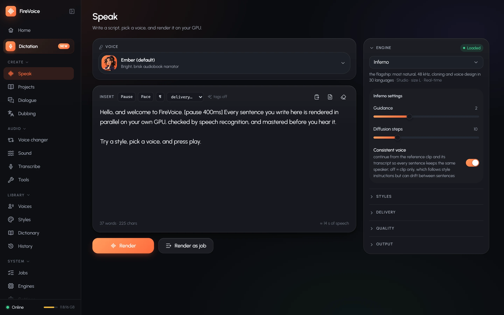
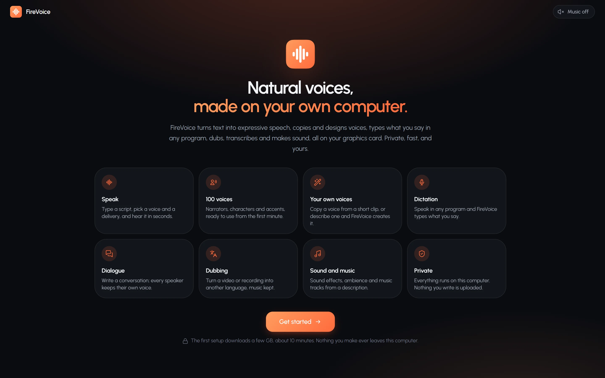
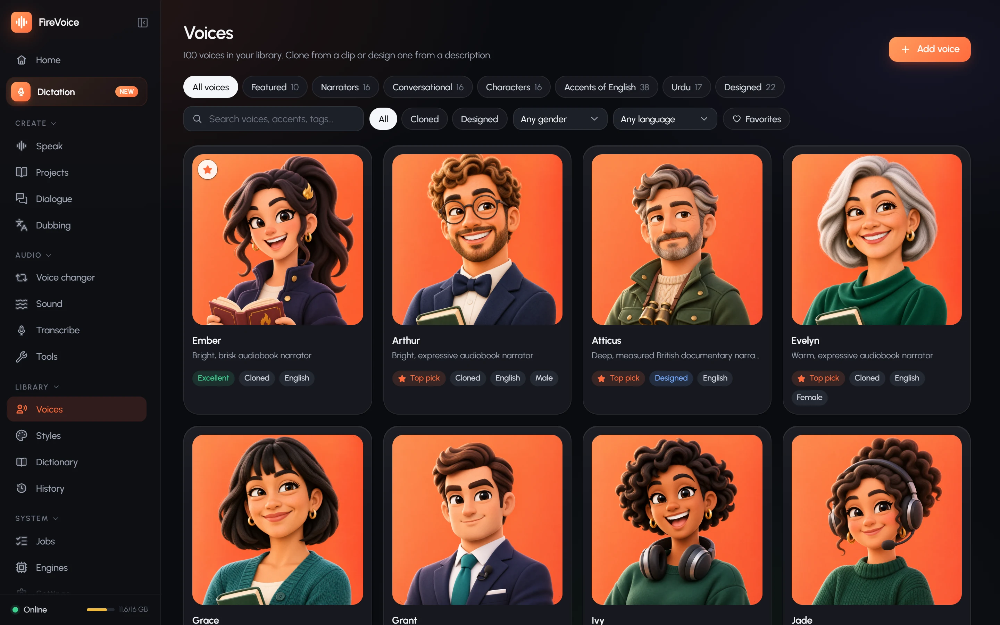
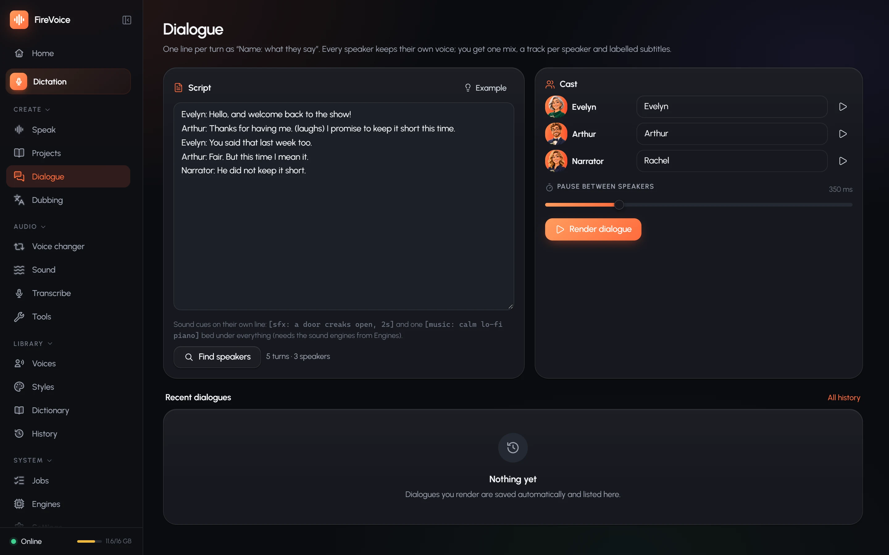
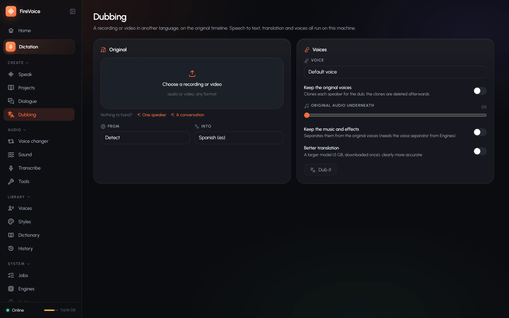
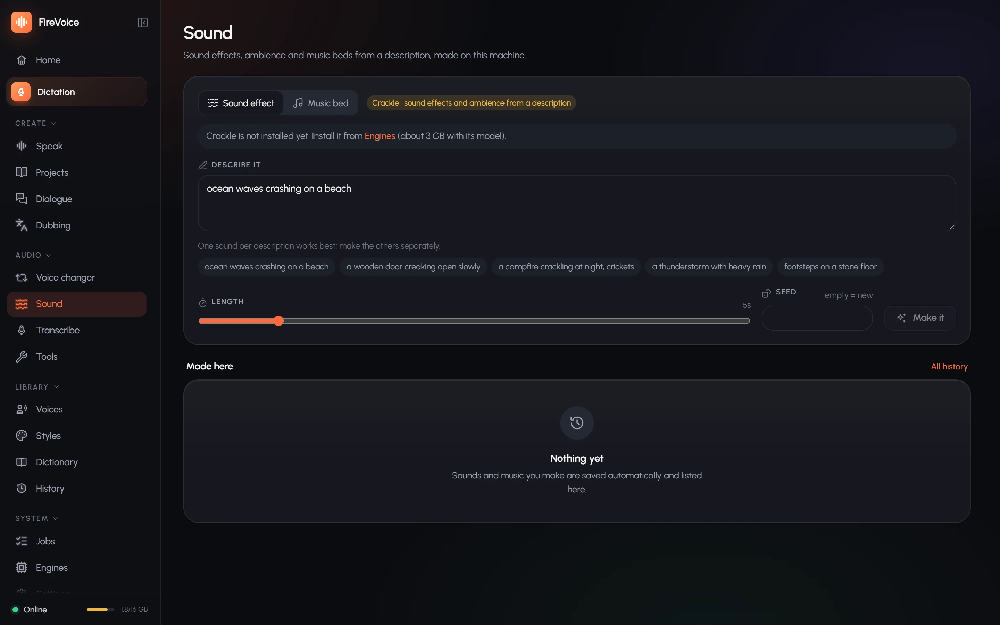

<div align="center">


# FireVoice

**Natural voices, made on your own computer.**

Expressive text to speech, voice cloning, dictation in any program, dialogue, dubbing, sound and transcription:
a desktop app that runs entirely on your own machine. Nothing you write or say is uploaded.

[](https://github.com/fabwaseem/firevoice/releases/latest)
[](LICENSE)
[](https://github.com/fabwaseem/firevoice/releases/latest)


[**Download**](https://github.com/fabwaseem/firevoice/releases/latest) ·
[Website](https://firevoice.fabwaseem.com) ·
[Report a bug](https://github.com/fabwaseem/firevoice/issues/new?template=bug_report.yml) ·
[Request a feature](https://github.com/fabwaseem/firevoice/issues/new?template=feature_request.yml)

<br />



</div>

## Features

| | |
|---|---|
| **Speak** | Type a script, pick a voice and a delivery, and hear it in seconds. Pauses, pace and styles inline; long scripts render sentence by sentence in parallel and are checked by speech recognition before you hear them. |
| **100 voices** | Narrators, characters and accents, ready from the first minute. |
| **Your own voices** | Clone a voice from a short clip, or describe one and FireVoice designs it. |
| **Dictation** | Hold a key and speak in any program; FireVoice types what you meant, punctuated, with an optional writing assistant that fixes grammar and follows voice commands. |
| **Dialogue** | Write a conversation; every speaker keeps their own voice, mixed into one track or one track per speaker with subtitles. |
| **Dubbing** | Turn a video or recording into another language on its original timeline, keeping the music and effects. |
| **Sound and music** | Sound effects, ambience and music beds from a description. |
| **Transcribe** | Speech to text with word timings, speaker labels and subtitles. |
| **Projects** | Audiobooks, courses and series: chapters of paragraphs, each with its own takes; re-render only what changed. |
| **Private** | Everything runs on your computer. Updates are signed and checked before they install. |

## Screenshots

<table>
  <tr>
    <td width="50%"></td>
    <td width="50%"></td>
  </tr>
  <tr>
    <td align="center"><sub>First run</sub></td>
    <td align="center"><sub>The voice library</sub></td>
  </tr>
  <tr>
    <td width="50%"></td>
    <td width="50%"></td>
  </tr>
  <tr>
    <td align="center"><sub>Dialogue</sub></td>
    <td align="center"><sub>Dubbing</sub></td>
  </tr>
  <tr>
    <td width="50%"></td>
    <td width="50%"></td>
  </tr>
  <tr>
    <td align="center"><sub>Sound and music</sub></td>
    <td align="center"><sub>Speak</sub></td>
  </tr>
</table>

## Download

Get the latest version from the [releases page](https://github.com/fabwaseem/firevoice/releases/latest) or the
[website](https://firevoice.fabwaseem.com).

| System | File |
|---|---|
| **Windows** 10 / 11 (64-bit) | `FireVoice_x.y.z_x64-setup.exe` (or the `.msi`) |
| **macOS** 11+ (Apple silicon) | `FireVoice_x.y.z_aarch64.dmg` |
| **Linux** (64-bit, Ubuntu 22.04 or newer) | `FireVoice_x.y.z_amd64.AppImage`, `.deb` or `.rpm` |

The first start sets FireVoice up: it downloads its voice engine and the voice library (a few GB, about ten minutes)
into its own folder, without touching any Python you may have installed. After that it works offline and updates
itself.

**Hardware.** An NVIDIA graphics card runs every engine its memory allows, fastest. Without one (AMD, Intel, Apple
silicon, or no card), FireVoice uses the processor and offers the engines that run well there. The Engines page says
what each one needs and whether it runs on your computer.

**macOS.** The app is not yet signed with an Apple Developer ID: open it the first time with right-click > **Open**
(or run `xattr -cr /Applications/FireVoice.app`). Dictation asks for the Accessibility permission to type into other
apps.

## How it works

FireVoice is a [Tauri 2](https://tauri.app) desktop app (Rust) with a React interface, and a Python voice engine that
it installs and runs on your computer behind a local HTTP API (FastAPI). Speech models run in their own environments,
so each engine keeps the libraries it needs.

```
backend/      the voice engine: Python package, HTTP API (docs at http://127.0.0.1:8787/docs while it runs), tests
src/          the app's interface (React 19, Vite, Tailwind CSS 4)
src-tauri/    the native shell: starts the engine, dictation, tray, updates
scripts/      development setup, bundling, versions and releases
docs/         the developer guide and screenshots
```

The local API is open to other programs too: anything that speaks HTTP can render speech, run jobs and read the
history while FireVoice is running.

## Build from source

You need [Node.js](https://nodejs.org) 24 with [pnpm](https://pnpm.io), [Rust](https://rustup.rs) and
[uv](https://docs.astral.sh/uv/) (it fetches the right Python by itself).

```bash
git clone https://github.com/fabwaseem/firevoice.git
cd firevoice
pnpm install
node scripts/dev-setup.mjs   # once: builds the engine's Python environment in backend/.venv
pnpm tauri dev               # the desktop app; it starts the engine by itself
```

The [developer guide](docs/DEVELOPMENT.md) covers the rest: running the UI or the engine alone, the tests, how the
first-run setup and updates work, dictation, and how releases are built and published.

## Contributing

Bug reports, ideas and pull requests are welcome. Read [CONTRIBUTING.md](CONTRIBUTING.md) before you start, and report
security problems privately as described in [SECURITY.md](SECURITY.md).

## License

FireVoice is released under the [MIT License](LICENSE).

The speech models FireVoice downloads are made by others and keep their own licenses; some are for non-commercial use
only. The Engines page and the [engine's README](backend/README.md) list each one.
